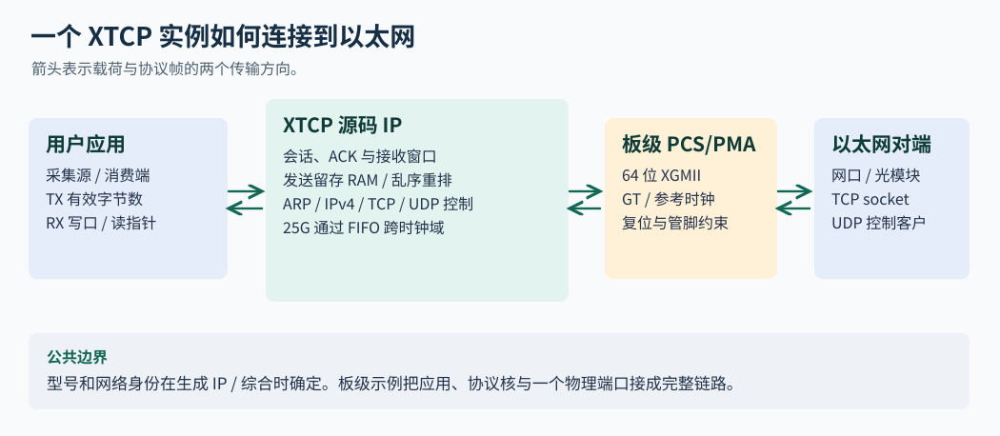

# XTCP

**v1.0.0 正式发布。** 三个型号均已在 RDX051 上完成实板功能、单向带宽与回显验收。25G-Jumbo 在同一位流上验证了 MTU 1500 和 9000。

XTCP 是 FPGA 上的 TCP/IPv4 端点。一个 Vivado IP Catalog 条目提供 **XTCP-10G**、**XTCP-25G**、**XTCP-25G-Jumbo** 三种编译配置。MAC、IPv4、TCP 监听端口和 UDP 控制端口都可以逐实例设置。包内含可综合 HDL、RDX051 参考设计、带字节校验的主机工具和线路仿真。



| 我想做什么 | 入口 |
|---|---|
| 第一次接入，了解所有用户接口与字节顺序 | [用户集成与接口手册](docs/用户集成与接口手册.md) |
| 在 Vivado 图形界面定制 | 将 `ip_repo` 注册为仓库，搜索 **XTCP**。[Block Design 操作步骤](docs/用户集成与接口手册.md#block-design) |
| 打开可编辑的 BD 实例 | [从空工程建立示例的 Tcl](tools/new_bd.tcl) |
| 在现有 RTL 工程中实例化 | [导入源码及约束](tools/integrate.tcl) · [公共 HDL 顶层](ip_repo/xtcp/hdl/xtcp.v) |
| 从头生成 RDX051 位流 | [板级构建脚本](boards/rdx051/build.tcl) · [重建步骤](docs/用户集成与接口手册.md#rdx051-build) |
| 换成自己的应用 | [参考源、汇、回显与寄存器逻辑](examples/xtcp_example_app.sv) |
| 用 PC 做功能和带宽测试 | [功能测试](tools/xtcp_client.py) · [Linux 吞吐测量](tools/xtcp_measure.py) |
| 核对位流、硬件条件、资源和实际吞吐 | [发布验证记录](docs/验证记录.md) |
| 校验解压包和依赖 | [校验工具](tools/verify_release.py) · [第三方组件说明](THIRD_PARTY.md) |

## 首次打开

在 Vivado 2025.2 Tcl Console 中，按实际解压位置修改第一行和输出位置。以下示例创建一套可双击定制的 25G-Jumbo BD 工程。MAC 为 `02:51:00:03:00:13`，IPv4 为 `192.168.10.13`。

```tcl
source {D:/fpga/XTCP/tools/new_bd.tcl}
xtcp_new_bd {D:/fpga/work/my_first_xtcp} 2 025100030013 C0A80A0D 23012 4612
```

将这个 BD 集成到自己的板之前，请根据手册连接所选型号对应的两个时钟端口、复位、XGMII 和用户流接口。在 RDX051 上可以直接按手册第 8 节使用板级示例。
