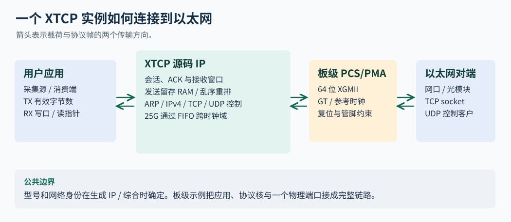
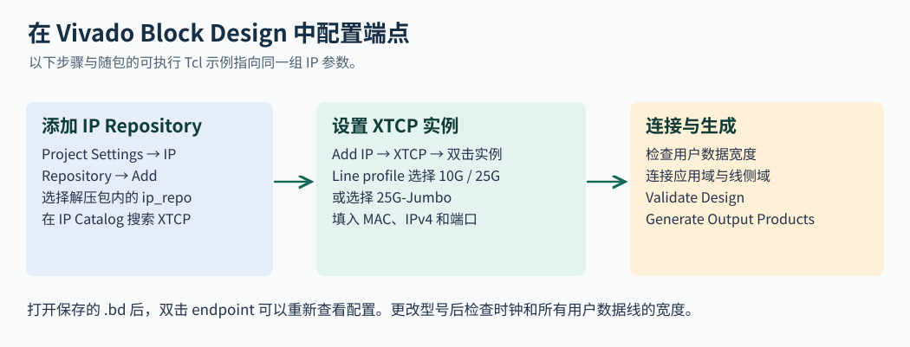
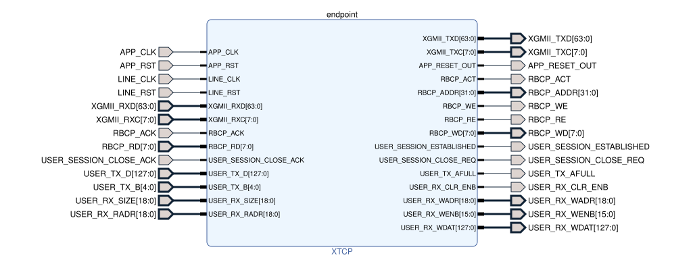
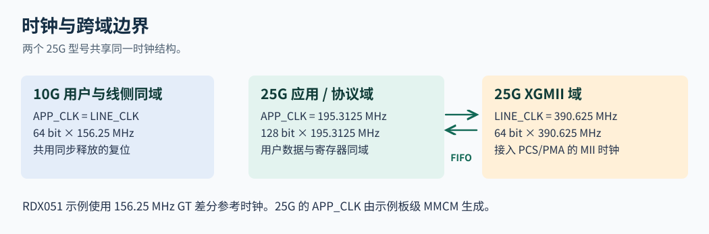
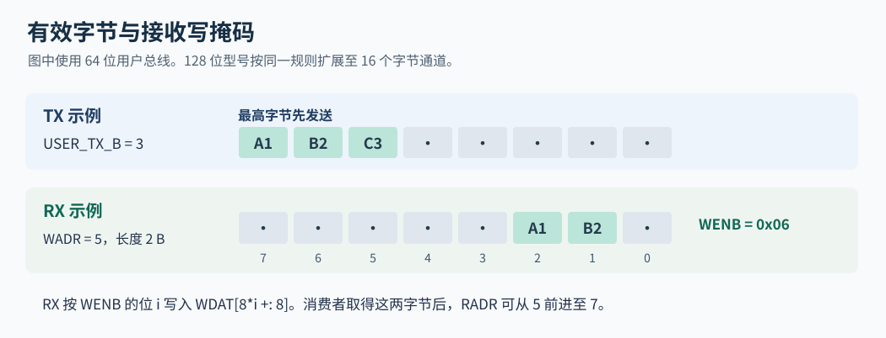

# XTCP 用户集成与接口手册

XTCP 是可综合的 FPGA IPv4/TCP 端点。主机用普通 TCP socket 连接 FPGA 的监听端口，可通过另一 UDP 端口访问用户寄存器。Vivado IP Catalog 中只有一个产品条目 **XTCP**。每个实例在定制时选择型号，设置本机 MAC、IPv4 和两个端口。



## 1　选择型号

| 配置项 | XTCP-10G | XTCP-25G | XTCP-25G-Jumbo |
|---|---:|---:|---:|
| `PROFILE` 参数值 | 0 | 1 | 2 |
| 线路额定速率 | 10 Gb/s | 25 Gb/s | 25 Gb/s |
| 用户 TX / RX 数据宽度 | 64 bit | 128 bit | 128 bit |
| 每拍最多用户字节 | 8 | 16 | 16 |
| `APP_CLK` | 156.25 MHz | 195.3125 MHz | 195.3125 MHz |
| `LINE_CLK` | 156.25 MHz | 390.625 MHz | 390.625 MHz |
| XGMII 数据 / 控制 | 64 / 8 bit | 64 / 8 bit | 64 / 8 bit |
| IPv4 MTU 上限 | 1500 B | 1500 B | 9000 B |
| IPv4/TCP 标准首部下的最大 MSS | 1460 B | 1460 B | 8960 B |
| RX 应用字节指针 | 18 bit | 19 bit | 19 bit |
| 参考应用 RX 物理环形空间 | 256 KiB | 512 KiB | 512 KiB |

一条实例服务一个独立的被动 TCP 连接。应用看到有序的连续字节流。发送端使用累计确认释放留存数据，接收端根据已接收和已消费的字节维护通告窗口。UDP 控制访问和 TCP 字节流可以共用该端口所在的物理链路。Jumbo 型号依据对端 SYN 的 MSS 选择发送段长，整条路径使用 MTU 1500 时可沿用标准帧。在 MTU 9000 的直接链路上使用大段时，主机数据接口及中间设备都需要容纳相应帧长。

## 2　从空工程使用 IP Catalog

本包的参考工具为 Vivado 2025.2。实板参考器件为 `xcku5p-ffvb676-2-i`。把发布包解压到本机持久目录，保留 `ip_repo/xtcp/component.xml`、`hdl` 和 `xgui` 的相对位置。

1. 启动 Vivado，选择 **Create Project → RTL Project**。输入工程名、选择器件，源文件可以稍后添加。
2. 在工程设置中进入 **Settings → IP → Repository**，点击 **+**，添加解压目录下的 `ip_repo`。确认后在 **IP Catalog** 搜索 `XTCP`，核对版本 `1.0` 和 VLNV `xtcp:network:xtcp:1.0`。
3. 在普通 RTL 工程中双击条目，输入组件名，例如 `xtcp_customized`。在 **Line profile** 选择型号，填写 **Local MAC (48 bits)**、**Local IPv4 (32 bits)**、**TCP listen port** 和 **UDP control port**。
4. 确认后执行 **Generate Output Products**。从 **Sources → IP Sources → Instantiation Template** 取得当前配置对应的 HDL 声明，把 `xtcp_customized` 接到自己的顶层。更改型号时重新核对数据宽度和时钟。
5. 25G 两种配置还要注册包内的跨域 FIFO 时序脚本。在 Tcl Console 中执行下例。板级时钟、GT 和管脚按所在板卡配置。RDX051 的完整示例会自动加入这些约束。

```tcl
source {D:/fpga/XTCP/tools/integrate.tcl}
xtcp::constraints 1
```

`xtcp::constraints 2` 对应 Jumbo。该命令将 `tools/axis_async_fifo.tcl` 登记到约束集并设置为 `LATE`，这样布局布线时可以找出已综合的异步 FIFO。检查器件设计中的 `report_cdc`、`report_bus_skew` 和 `report_timing_summary`。

<a id="block-design"></a>

## 3　在 Block Design 中设置并连接



1. 完成仓库注册，选择 **IP Integrator → Create Block Design**。在 Diagram 点 **Add IP**，搜索并加入 **XTCP**。
2. **双击画布上的端点实例**进入定制窗口。例选 `XTCP-25G-Jumbo`，MAC 填 `0x025100030013`，IPv4 填 `0xC0A80A0D`，TCP 填 `0x59E4`，UDP 填 `0x1204`。本例实际使用 `192.168.10.13`、TCP `23012`、UDP `4612`。点 **OK** 后可用下面的 Tcl 直接读回。
3. 应用逻辑接 `USER_*` 和 `RBCP_*`，板级 PHY 接 `XGMII_*`。可以在 BD 内连接，也可以对所需引脚选择 **Make External**，再由外层 HDL 连接。将 25G 的 `APP_CLK` 与 `LINE_CLK` 分别接到表 1 的两个时钟，复位分别同步释放。
4. 执行 **Validate Design**，保存设计，运行 **Generate Output Products**。希望以该 BD 作为顶层时，在 Sources 中右击 `.bd` 选择 **Create HDL Wrapper**。发布的 RDX051 BD 构建使用外层板顶层实例化生成的 `xtcp_design`，板级 GT 和时钟在外层。
5. 双击保存的 `.bd` 可重新进入 Diagram，双击原实例可重新设置。先更改型号，再生成 output products，便于发现外接数据线、`USER_TX_B` 和 RX 地址上的宽度不匹配。

```tcl
# 假定 BD 实例名为 endpoint
set endpoint [get_bd_cells endpoint]
get_property CONFIG.PROFILE $endpoint
get_property CONFIG.LOCAL_MAC $endpoint
get_property CONFIG.LOCAL_IP $endpoint
get_property CONFIG.TCP_PORT $endpoint
get_property CONFIG.RBCP_PORT $endpoint
get_property LEFT [get_bd_pins endpoint/USER_TX_D]
```

**打开一个可实际操作的示例**。在一个尚未打开工程的 Vivado 窗口，运行以下两行。输出位置使用新目录，工程保留在窗口中，可以直接双击 `endpoint`。脚本会注册仓库、创建该 BD、引出所有端口、加约束、验证设计并生成 wrapper。

```tcl
source {D:/fpga/XTCP/tools/new_bd.tcl}
xtcp_new_bd {D:/fpga/work/my_endpoint} 2 025100030013 C0A80A0D 23012 4612
```



定制值保存在该工程的 XCI / BD 中。对多个实例或多块板分配不同的局部管理单播 MAC，并在同一子网分配不同的 IPv4。默认地址与板级示例地址见第 4 节。Vivado 的 BD 定制方法可查 [AMD《Designing IP Subsystems Using IP Integrator》](https://docs.amd.com/r/2025.2-English/ug994-vivado-ip-subsystems/Hierarchical-IP-in-IP-Integrator)。

## 4　直接 RTL 与地址配置

已有 HDL 工程可在当前 Vivado 工程的 Tcl Console 中执行 `source {D:/fpga/XTCP/tools/integrate.tcl}`，再执行 `xtcp::rtl 1`。该命令一次加入公共顶层、各型号实现及所需依赖，设置 XPM 库并注册所选型号的约束。用户顶层实例化 `xtcp`，参数值由 Verilog elaboration 确定。

| 参数 | IP 默认值 | 作用 |
|---|---|---|
| `PROFILE` | `0` | 0 为 10G，1 为标准 25G，2 为 25G-Jumbo |
| `LOCAL_MAC` | `48'h02_51_00_03_00_01` | 本机以太网 MAC，48 位，高字节先写 |
| `LOCAL_IP` | `32'hC0_A8_0A_0A` | 本机 IPv4，默认 192.168.10.10 |
| `TCP_PORT` | `16'd24` | FPGA 被动监听的 TCP 端口，1–65535 |
| `RBCP_PORT` | `16'd4660` | UDP 寄存器访问服务端口，1–65535 |

例如把 `.PROFILE(1)`、`.LOCAL_MAC(48'h02_51_00_03_00_12)`、`.LOCAL_IP(32'hC0_A8_0A_0C)`、`.TCP_PORT(16'd23011)`、`.RBCP_PORT(16'd4611)` 放在 `xtcp #(…) endpoint (…)` 的参数表中，就是一块独立地址的标准 25G 板。完整连线可直接参考 [25G 板级顶层](../boards/rdx051/line25/xtcp_rdx051.v) 和 [公共端口声明](../ip_repo/xtcp/hdl/xtcp.v)。

参考板构建脚本也接受以上五个参数，并把相同的值分别交给协议核和可回读身份的示例外设。修改参数后，重新生成 IP、实现及位流，然后下载。示例身份区 `0x40` 只读，软件可通过它确认本次在板上运行的配置。

## 5　时钟、复位与物理层



`APP_CLK` 驱动协议状态、用户数据和应用寄存器。`APP_RST` 为高有效。`APP_RESET_OUT` 给用户逻辑提供同域复位。`LINE_CLK` 驱动 64 位 XGMII，在 10G 配置中将两个时钟端接至同一时钟，两个复位端接同一同步释放的复位。在两种 25G 配置中，线侧至用户侧有双向宽度转换和跨域 FIFO，分别对两个域释放复位。

XGMII 的 `XGMII_RXD[63:0]`、`XGMII_RXC[7:0]` 由 PHY 送入 XTCP。`XGMII_TXD[63:0]`、`XGMII_TXC[7:0]` 由 XTCP 发往 PHY。每个控制位对应一个字节通道，XGMII 的 lane 0 在 `[7:0]`。用户字节流的最高字节通道承载第一个有效字节。连接时分别遵守两侧的字节约定。

参考设计使用一个 GTY lane 的 10GBASE-R / 25GBASE-R PCS/PMA。RDX051 的近 USB QSFP 口使用 `Quad_X0Y3 / X0Y12`，GT 参考时钟为 156.25 MHz，25G 配置关闭 FEC。将这套设计移到自己的板卡时，选择自己的器件、可用 lane、参考时钟源和 PHY 配置，按本板管脚、极性、模块复位及光模块状态修改顶层和 XDC。链接后先核对 block lock、local fault、对端速率与 FEC，再检查 ARP 和 TCP。

## 6　用户接口逐项说明

方向以 XTCP 核为参照。下表应用与控制口均在 `APP_CLK` 上升沿工作。

| 端口 | 方向 | 含义及连接要求 |
|---|---|---|
| `USER_SESSION_ESTABLISHED` | 出 | 当前 TCP 会话进入可处理用户流的状态。会话结束时应用复位本次流的状态。 |
| `USER_SESSION_CLOSE_REQ` / `USER_SESSION_CLOSE_ACK` | 出 / 入 | 对端发来关闭请求。应用排空已接收数据、完成待发送的尾部后给 ACK。示例可立即应答，内核继续处理待确认字节与关闭握手。 |
| `USER_TX_D` / `USER_TX_B` | 入 / 入 | 写入用户字节。`TX_B=0` 表示本拍空闲，10G 合法值 1–8，25G 合法值 1–16。最高字节先进入 TCP 流，无效字节可填零。 |
| `USER_TX_AFULL` | 出 | 发送留存缓冲接近满或当前不接受新流。应用停止发起新增字节，在缓冲恢复后继续；参考应用最多保留两拍已经在途的回显数据。 |
| `USER_RX_SIZE` | 入 | 应用提供的接收空间容量，单位为字节。示例用 `(1 << 指针位宽) - 16` 留出区分环状态的余量。实际通告窗口还受内部上限、对端协商及读指针影响。 |
| `USER_RX_WADR` / `USER_RX_WDAT` / `USER_RX_WENB` | 出 | 写入应用的字节地址、总线数据、逐字节有效掩码。对每个有效位 `i`，写入 `WDAT[8*i +: 8]` 对应的 RAM lane。用地址高位选行，低位及掩码表示行内位置。 |
| `USER_RX_RADR` | 入 | 应用已消费到的位置，指向下一个要读取的字节。只有完成本地读出后才推进；读写指针均按其位宽自然回绕。 |
| `USER_RX_CLR_ENB` | 出 | 监听或建连期间允许应用重新对齐读指针。示例在该信号有效且会话未建立时令 `RADR=WADR`。 |
| `RBCP_ACT` | 出 | 一次控制事务正处于处理状态。 |
| `RBCP_ADDR[31:0]` / `RBCP_WD[7:0]` | 出 | 当前控制字节地址与写数据。多字节访问被分解为连续字节事务。 |
| `RBCP_RE` / `RBCP_WE` | 出 | 当前字节的读 / 写请求脉冲。应用锁存地址、译码后返回应答。 |
| `RBCP_ACK` / `RBCP_RD[7:0]` | 入 | 当前字节完成，读事务同时给出读数据。建议用同步寄存器返回，避免从地址经大段组合逻辑直接驱动应答。 |



**RX 接口有两个不同的动作。** 在 `WENB` 有效的每拍把数据写到接收环；应用以自己的读指针消费环内已提交的数据。即使只需要计数或立即消费，也要正确更新 `RADR`，否则主机会逐步受到接收窗口限制。参考应用对同一周期的同址读写带有转发，以保证很短的回显也能取到新字节。

**发送留存。** 每个型号的发送留存 RAM 是 256 KiB。发送后在对端累计确认对应序号前仍保留字节，以支持重发。应用在 `AFULL` 后停止新增传输，256 B 预留量用于应用反应与已注册的在途字节。把发送与消费的计数和 TCP 确认分开，有助于诊断接收端回压和链路丢包。

## 7　参考应用与主机测试

参考应用 [xtcp_example_app.sv](../examples/xtcp_example_app.sv) 提供三种工作方式。`0x04=0x00` 时 FPGA 消费主机发来的字节；`0x04=0x01` 时 FPGA 发送有限长度的递增序列；`0x04=0x40` 时 FPGA 将实际收到的字节回显。源端从 `01` 递增到 `FF` 后回到 `01`，每次新会话重新开始。数据长度为字节，可以不是应用字宽或 MSS 的整数倍。

| RBCP 字节地址 | 长度 | 属性 | 内容 |
|---|---:|---|---|
| `0x0000` | 4 | 读 | 示例应用标识，`0x01000010 + PROFILE` |
| `0x0004` | 1 | 读写 | 工作方式，在连接建立前设置 |
| `0x0010` | 1 | 读写 | 源发送速率，每单位 100 Mb/s，10G 满档 100、25G 满档 250 |
| `0x0018` | 8 | 读写 | 源发送的总字节数，高字节在低地址 |
| `0x0040` | 18 | 读 | `XTCP` 四字节、MAC 六字节、IPv4 四字节、TCP 端口两字节、UDP 端口两字节 |
| `0x0100` | 4 | 读 | ASCII `XTCP` |
| `0x0104` / `0x0105` | 各 1 | 读 | 型号；状态位 2 回显、位 1 源、位 0 会话已建立 |
| `0x0106` | 2 | 读 | 板级状态。RDX051 示例低位 0–5 依次为 block lock、RX status、high BER、RX fault、TX fault、GT power-good |
| `0x0108` | 1 | 写 | 写 `1` 锁存同一时刻的应用计数 |
| `0x0110` | 48 | 读 | 快照依次为 TX 字节、RX 已消费字节、AFULL 周期、时钟周期（各 64 位），会话数、快照序号、保留（各 32 位），历史与当前板级标志（各 16 位） |
| `0x0200–0x03FF` | 两页 | 核内 | 协议核状态和统计内存映射。自定义外设选择其他地址，示例控制与状态页位于 `0x0000–0x01FF`。 |

主机使用 Python 3.9 或更高版本的标准库即可复核身份、完整数据和快照。以 Jumbo 参考配置为例，主机直连数据口地址为 `192.168.10.20/24`。将对端、端口与自己烧录的参数对应，先运行 probe，然后做带奇数尾字节的 echo。命令行中的 `send` 和 `receive` 都以主机为视角。

```sh
python3 tools/xtcp_client.py probe   192.168.10.13 --bind 192.168.10.20 --tcp 23012 --udp 4612
python3 tools/xtcp_client.py echo    192.168.10.13 --bind 192.168.10.20 --tcp 23012 --udp 4612 --bytes 65539
python3 tools/xtcp_client.py receive 192.168.10.13 --bind 192.168.10.20 --tcp 23012 --udp 4612 --bytes 1048593
python3 tools/xtcp_client.py send    192.168.10.13 --bind 192.168.10.20 --tcp 23012 --udp 4612 --bytes 1048593
```

`probe` 读硬件实际配置，`echo` 一边发送一边逐字节校验回包，`send` 检查 FPGA 已消费的字节数，`receive` 核对源数据及快照。每次传输结束后，工具恢复运行前的方式、速率和长度。吞吐测量与 CPU 口径见 [发布验证记录](验证记录.md)。

短回显使用按流内位置生成的 SHAKE-256 数据，包含零字节和非周期尾部。要测高吞吐，在 Linux 中编译随包原生客户端，以相同身份参数运行测量。输出文件使用新的名字。可选参数 `--rate` 以 100 Mb/s 为单位设置 FPGA 源的目标速率。原生工具逐字节校验源或回显数据，并记录 CPU 用户态及内核态时间、TCP_INFO 和分段字节数。

```sh
cc -O3 -std=gnu11 -Wall -Wextra -pthread tools/linux/xtcp_perf.c -o /tmp/xtcp_perf
/tmp/xtcp_perf --selftest
python3 tools/xtcp_measure.py receive 192.168.10.13 --bind 192.168.10.20 --tcp 23012 --udp 4612 --binary /tmp/xtcp_perf --bytes 4294967313 --output /tmp/xtcp-receive01.json
```

<a id="rdx051-build"></a>

## 8　从空目录重建 RDX051 参考工程

在 Vivado 2025.2 命令环境中，从解压包根目录执行下列命令。三个输出目录均使用新的路径。Windows 中可将 `vivado` 换成安装目录下的 `vivado.bat`。

```sh
vivado -mode batch -source boards/rdx051/build.tcl -tclargs D:/fpga/work/xtcp10 0 rtl     025100030011 C0A80A0B 23010 4610
vivado -mode batch -source boards/rdx051/build.tcl -tclargs D:/fpga/work/xtcp25 1 catalog 025100030012 C0A80A0C 23011 4611
vivado -mode batch -source boards/rdx051/build.tcl -tclargs D:/fpga/work/xtcp25j 2 bd     025100030013 C0A80A0D 23012 4612
```

若省略最后四个地址参数，脚本为型号 0 / 1 / 2 分配 MAC 尾字节 `11` / `12` / `13`、IPv4 `.11` / `.12` / `.13`，TCP 和 UDP 端口使用 24 和 4660。表中完整命令对应专门定制的三个端口组合。`products/xtcp_rdx051.bit` 为整板位流，`.ltx` 为配套的状态探针，`reports/` 含时序、路由、设计规则和资源报告。可从输出目录打开 `xtcp_example.xpr` 检查工程；BD 构建在 Sources 中可打开 `xtcp_design.bd`。

每种线路速率选用额定支持该速率的 AOC、DAC 或收发模块。跨速率使用时检查厂商给出的工作范围或双速模式；链路建立后对照网卡 RX CRC 和 FPGA 侧坏 FCS 的增量，持续增加时先解决物理链路。

在 Hardware Manager 中选择自己板卡对应的硬件目标，检查器件型号，将同一输出目录的 `.bit` 和 `.ltx` 配对后下载到 SRAM。先查看链路状态，再从主机做 ARP、身份寄存器和短回显。应用功能正常后，逐步加大流量。

## 9　复现实验与移植检查

- **线路仿真**。从包根目录运行 `vivado -mode batch -source sim/run.tcl -tclargs D:/fpga/work/sim_jumbo 2`。最后一个参数可换为 0 或 1。测试主机通过 XGMII 发送控制报文，核对身份与读写应答，按 TCP 三次握手建连，校验回显的每个字节及 Ethernet FCS、IPv4/TCP 校验和，随后正常关闭。仿真目录保存 `xtcp_frames.txt`，每一行含时钟拍、方向和完整以太帧。
- **Catalog 验证**。运行 `vivado -mode batch -source tools/catalog_test.tcl -tclargs D:/fpga/work/catalog_test`，可在同一个空工程中创建三个独立 BD 和三个普通 Catalog 实例。`catalog_results.tsv` 保存定制后的 MAC、IPv4 和端口宽度。
- **移植到其他板**。先选一个型号，用板上的 PHY 单独取得稳定 block lock，根据时钟树连接 `APP_CLK` 和 `LINE_CLK`。接入参考应用以便先复现 `probe → echo → send/receive`。用每个端口自己的 MAC/IP 编译，在物理网上确认 ARP 与配置相符。最后替换参考应用，保留流控、环形读指针和关连接的行为。
- **定位首次接入问题**。有链路却没有 ARP 时，先对照 MAC/IP 和 XGMII 时钟、复位。ARP 正常而控制超时时，核对 UDP 端口、地址译码及 `RBCP_ACK`。建连正常而主机发送变慢时，观察 `USER_RX_RADR` 的推进、应用 RX 计数和主机接收窗口限制。Jumbo 仅在传大段时异常时，核对两端 MTU、协商 MSS 与链路上的实际帧长。
