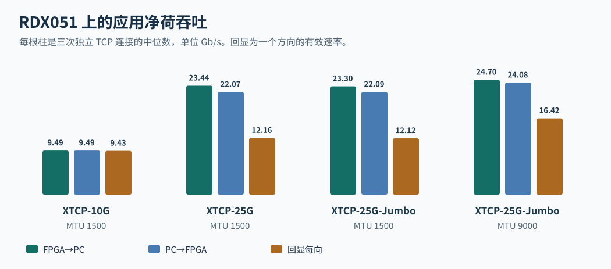

# XTCP 发布验证记录

本次验收使用 Vivado 2025.2、RDX051 的 KU5P 和 MS-02 Ultra 的 Intel E810 数据口。三个输入工程来自解压后的交付源码。每个型号从空工程生成完整板级位流，定制各自的 MAC、IPv4 以及 TCP、UDP 端口。

## 从工程到线路的验证

| 型号 | 实板位流的接入方法 | MAC | IPv4 | TCP / UDP | 线侧仿真每向核对 |
|---|---|---|---|---|---:|
| XTCP-10G | RTL | 02:51:00:03:00:11 | 192.168.10.11 | 23010 / 4610 | 1,478 B |
| XTCP-25G | IP Catalog | 02:51:00:03:00:12 | 192.168.10.12 | 23011 / 4611 | 1,478 B |
| XTCP-25G-Jumbo | Block Design | 02:51:00:03:00:13 | 192.168.10.13 | 23012 / 4612 | 10,438 B |

另一个空工程对三个普通 Catalog 实例和三个独立 BD 分别定制、验证并生成 output products。检查了 MAC 全部 48 位、IPv4、两个端口及实际用户数据、掩码、字节数和地址宽度。GUI 示例在保存后重新打开 BD，验证参数保留。原生 BD 图从 Vivado GUI 导出。线路仿真由独立的 XGMII 对端构造和解析报文，覆盖 UDP 控制读写、TCP 握手、奇数尾部、回显和正常关闭。对保存的线路字节再次计算 Ethernet CRC、IPv4/TCP 校验和并检查地址与有效载荷长度。

## 实板测试方法

在同一张 RDX051 上逐一下载三个公开配置对应的 SRAM 位流。每次读取 JTAG 器件身份、配置完成状态，将应用身份区和主机 ARP 邻居表与编译配置交叉核对。测试在隔离的数据接口与 IPv4 子网中进行。25GBASE-R 链路使用关闭 FEC 的配置。

每种 MTU 条件先做 11 个短回显，长度依次为 1、7、8、15、16、17、1460、1461、8960、8961、65539 B。主机按位置生成内容并逐字节比较收到的回包，然后各跑一次 1,048,593 B 的源与汇测试，核对应用快照。字节流长度跨越 MSS 时由 TCP 分段。

带宽使用随包 Linux C 客户端，每个方向三次新建连接。两种单向场每次传 4 GiB + 17 B，回显每次传 1 GiB + 17 B/向。发送计时包括主机待确认数据排空，接收与回显对回包逐字节校验。另由 UDP 快照核对 FPGA 发送与消费字节。下表速率使用十进制 Gb/s，回显按每向算一次。CPU 为进程 user+system 时间除以本场完成时间，100% 表示一个逻辑核心。全机忙碌及 IRQ 数据来自测量前后的 /proc/stat，可能包括同时运行的系统工作。

| 型号 / MTU | 方向 | 中位 Gb/s | 最低–最高 Gb/s | 进程 CPU 中位 | 全机忙碌中位（核） | 主机 / FPGA 重传合计 |
|---|---|---:|---:|---:|---:|---:|
| XTCP-10G / 1500 | FPGA→PC | 9.487 | 9.476–9.488 | 25.3% | 0.44 | 0 / 0 |
| XTCP-10G / 1500 | PC→FPGA | 9.486 | 9.477–9.490 | 13.1% | 0.32 | 0 / 0 |
| XTCP-10G / 1500 | 回显每向 | 9.427 | 9.389–9.430 | 79.6% | 0.84 | 0 / 4 |
| XTCP-25G / 1500 | FPGA→PC | 23.443 | 23.301–23.482 | 61.9% | 1.08 | 0 / 0 |
| XTCP-25G / 1500 | PC→FPGA | 22.068 | 22.043–22.126 | 44.2% | 0.53 | 0 / 0 |
| XTCP-25G / 1500 | 回显每向 | 12.155 | 9.852–12.172 | 96.9% | 1.31 | 0 / 11 |
| XTCP-25G-Jumbo / 1500 | FPGA→PC | 23.296 | 23.271–23.377 | 67.1% | 1.17 | 0 / 0 |
| XTCP-25G-Jumbo / 1500 | PC→FPGA | 22.093 | 21.971–22.120 | 44.0% | 0.57 | 0 / 0 |
| XTCP-25G-Jumbo / 1500 | 回显每向 | 12.115 | 11.561–12.392 | 99.7% | 1.32 | 0 / 2 |
| XTCP-25G-Jumbo / 9000 | FPGA→PC | 24.702 | 24.701–24.709 | 48.5% | 0.70 | 0 / 0 |
| XTCP-25G-Jumbo / 9000 | PC→FPGA | 24.077 | 23.796–24.311 | 38.2% | 0.58 | 0 / 0 |
| XTCP-25G-Jumbo / 9000 | 回显每向 | 16.419 | 16.346–21.942 | 76.7% | 0.95 | 0 / 0 |

### 10G 线材复核

同一 10G 位流最初接在标称 26000 MBd 的 25G AOC 上，短功能通过。分档诊断时，E810 网卡 RX CRC 增加 63，FPGA 收到坏 FCS 增加 17。随后更换 10G AOC，网卡读到 HUAWEI SFP-10G-SR、标称 10300MBd，FPGA 的 MAC、IP、端口、位流哈希及主机数据接口均沿用原配置。表中 10G 带宽取自更换后的完整三轮数据。

| 型号 / MTU | 整轮主机网卡 RX CRC 增量 | 九场带宽传输 FPGA 坏 FCS 增量 |
|---|---:|---:|
| XTCP-10G / 1500 | 0 | 0 |
| XTCP-25G / 1500 | 0 | 0 |
| XTCP-25G-Jumbo / 1500 | 0 | 0 |
| XTCP-25G-Jumbo / 9000 | 0 | 0 |

以完整标准 IPv4/TCP 首部、单向满长无 VLAN 以太帧计算，1500 MTU 时净荷上限约为 9.493 / 23.732 Gb/s，9000 MTU 的 25G 约为 24.784 Gb/s。计算式为线路速率 × MSS ÷ (MTU + 38)，38 B 包括以太网头、FCS、前导码及帧间隔。小段、确认、主机调度和控制流量会改变实测速率。

## 同一位流的资源与时序

下列资源取自 RDX051 布线后层次报告。整板行包含 XTCP、应用接收环、PHY、调试核和其他板级逻辑。核行只列示例中协议核实例的层次资源，综合跨层优化会影响层次归属。BRAM 列分别是 36 Kb 和 18 Kb 原语数量。

| 型号 | 统计范围 | LUT | FF | RAMB36 | RAMB18 | URAM | DSP |
|---|---|---:|---:|---:|---:|---:|---:|
| XTCP-10G | 整板 | 17,095 | 13,416 | 146 | 0 | 4 | 1 |
| XTCP-10G | XTCP | 14,156 | 8,807 | 82 | 0 | 4 | 1 |
| XTCP-10G | 参考应用 | 689 | 1,059 | 64 | 0 | 0 | 0 |
| XTCP-25G | 整板 | 26,740 | 16,129 | 326 | 2 | 4 | 1 |
| XTCP-25G | XTCP | 23,215 | 11,272 | 198 | 2 | 4 | 1 |
| XTCP-25G | 参考应用 | 1,319 | 1,270 | 128 | 0 | 0 | 0 |
| XTCP-25G-Jumbo | 整板 | 26,851 | 16,078 | 344 | 2 | 32 | 1 |
| XTCP-25G-Jumbo | XTCP | 23,385 | 11,227 | 216 | 2 | 32 | 1 |
| XTCP-25G-Jumbo | 参考应用 | 1,265 | 1,271 | 128 | 0 | 0 | 0 |

| 型号 | 最差建立裕量 ns | 最差保持裕量 ns | 最差脉宽裕量 ns | 未约束内部端点 | 路由错误 |
|---|---:|---:|---:|---:|---:|
| XTCP-10G | 0.043 | 0.011 | 0.455 | 0 | 0 |
| XTCP-25G | 0.127 | 0.012 | 0.400 | 0 | 0 |
| XTCP-25G-Jumbo | 0.032 | 0.014 | 0.400 | 0 | 0 |

三套整板的建立、保持和脉宽检查均收敛，布线完成。发布数据文件同时保留 DRC / methodology 常规告警的规则名与计数。板卡、速度等级、布局或应用逻辑改变后应重新实现并检查时序。

## 产品身份与验收范围

| 型号 | 实测 RDX051 BIT 的 SHA-256 |
|---|---|
| XTCP-10G | `dafaf0a6f8caa15b275b795ba02abaec40bd02bfcc41e07aad2da21fa3aa9c6d` |
| XTCP-25G | `26facb589fe041e09cc0cb7fbdf814c5dcdeb48aa97c323f2ff589ac5e9fca28` |
| XTCP-25G-Jumbo | `bf3c3c8bbc313e737ac6d21719e8417968144d7ccc11a5ffea3e763181801f5e` |

本次实板证据覆盖一个物理端口、每实例一个 TCP 会话，以及 Jumbo 位流在两种 MTU 下的行为。各型号的功能与性能覆盖以上表和记录为准。测试边界是上列固定字节数与连接次数。异板时序、多实例并行与该发布位流的一小时连续运行需要各自独立验证。

每次传输的净荷、持续时间、进程 CPU、主机 TCP 重传和 FPGA 计数均保存在 [机器可读验证数据](data/validation.json)。硬件参考包附匹配的 BIT、LTX 和文件清单。
